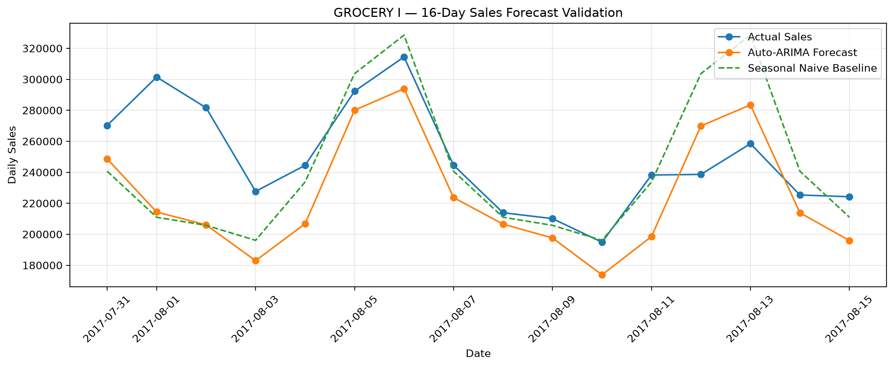

# Retail Sales Forecasting

## Project Overview
This project explores historical retail sales data from Kaggle's Store Sales - Time Series Forecasting competition and develops statistical time-series forecasting models to predict future sales.

The dataset covers 54 stores and 33 product families.

## Technologies Used
- Python
- Pandas
- Matplotlib
- SARIMA / SARIMAX
- Auto-ARIMA
- Jupyter Notebook

## Project Workflow
1. Clean and explore historical sales data.
2. Analyze seasonal trends, promotions, oil prices, and calendar effects.
3. Engineer lag and rolling-window features.
4. Develop and evaluate time-series forecasting models.
5. Generate and validate a Kaggle submission containing 28,512 predictions.

## Results
The Auto-ARIMA model achieved an RMSE of **37,880.70**, compared with **40,209.50** for a fixed-origin seasonal naïve baseline, representing a **5.79% reduction in RMSE**.

These results were obtained using a 16-day historical holdout (July 31–August 15, 2017) for the **GROCERY I** product family, with sales aggregated across stores. This is a single-family evaluation, not a performance claim across the full dataset.
### Forecast Visualization

## Dataset
[Kaggle Store Sales - Time Series Forecasting](https://www.kaggle.com/competitions/store-sales-time-series-forecasting)

## How to Run
1. Download the dataset from Kaggle.
2. Open `store-sales-time-series-forcasting.ipynb` in Jupyter Notebook or Google Colab.
3. Update the dataset file paths to match your environment.
4. Install the required Python libraries and run the notebook cells in order.

Note: The notebook uses Kaggle-specific data paths and may require adjustments outside Kaggle.

## Future Improvements
- Review time-series validation to prevent data leakage.
- Improve reproducibility with a requirements file and portable paths.
- Compare additional forecasting models.
